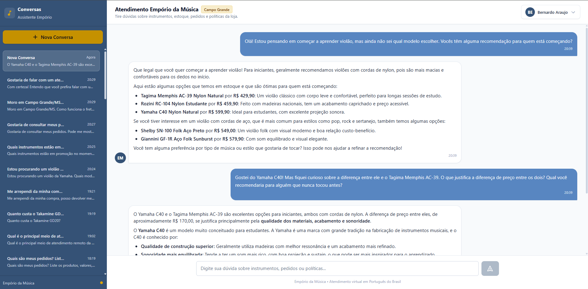
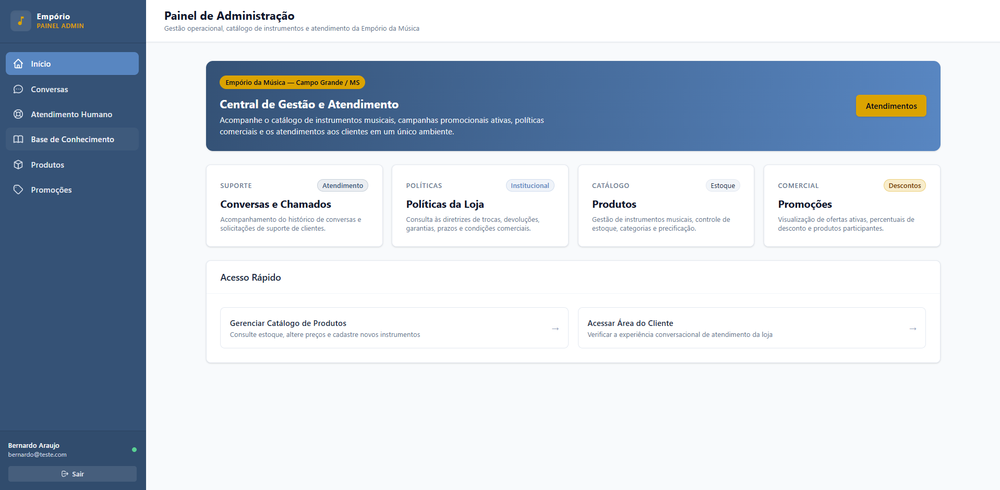
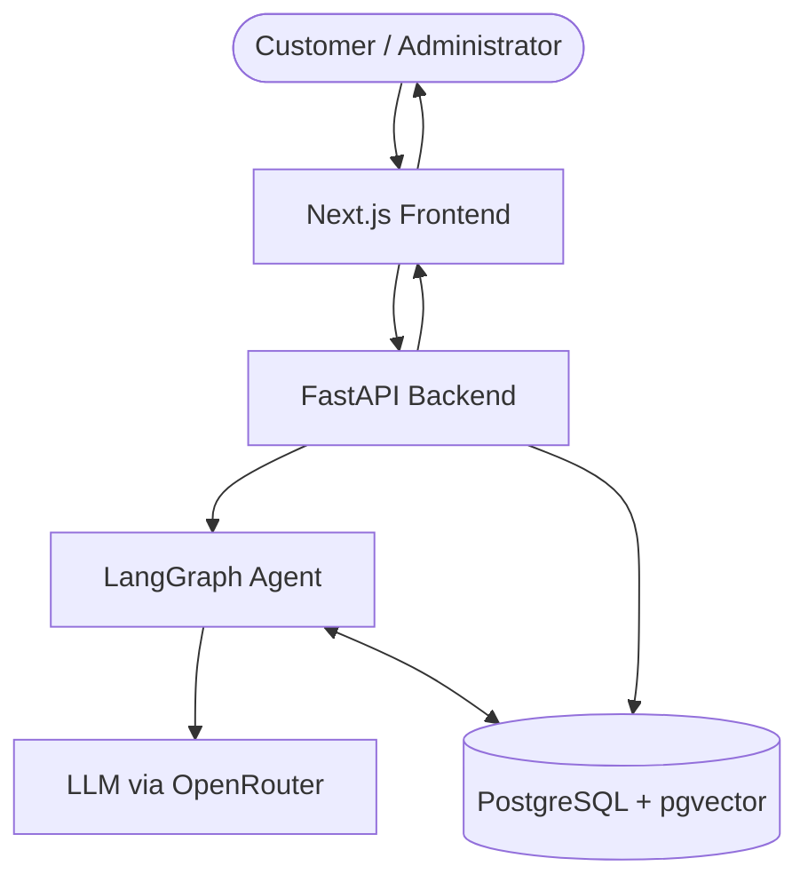
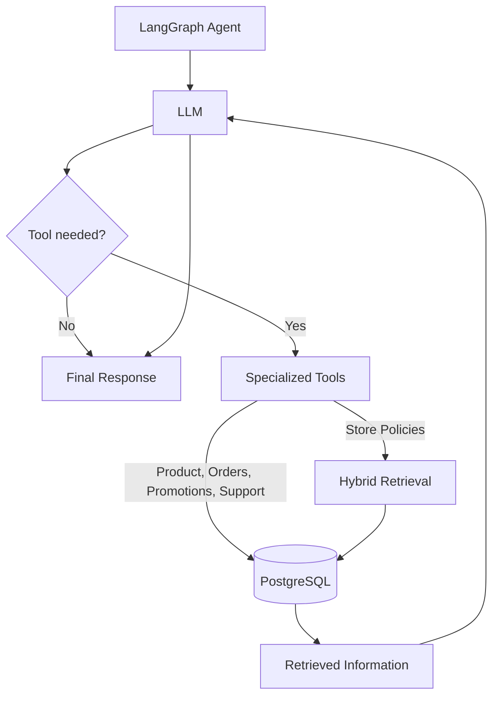

# Empório da Música — AI Customer Support Platform

[](https://www.python.org/)
[](https://fastapi.tiangolo.com/)
[](https://nextjs.org/)
[](https://github.com/pgvector/pgvector)
[](https://github.com/langchain-ai/langgraph)

An AI-powered customer service and administrative platform developed for **Empório da Música**, a musical instrument store based in Campo Grande, Mato Grosso do Sul, Brazil.

The platform combines an LLM-powered conversational assistant with deterministic tools for transactional data and hybrid RAG for document-based answers. It also includes a backoffice administration panel for catalog management, promotion monitoring, conversation auditing, and human support escalation.

---

## Table of Contents

1. [Overview & Features](#overview--features)
2. [Architecture & Request Flow](#architecture--request-flow)
3. [Technical Decisions & Justifications](#technical-decisions--justifications)
4. [Security & Access Control](#security--access-control)
5. [AI Agent Workflow & Tools](#ai-agent-workflow--tools)
6. [Hybrid Retrieval Strategy (RAG)](#hybrid-retrieval-strategy-rag)
7. [Technology Stack](#technology-stack)
8. [Project Structure](#project-structure)
9. [Getting Started](#getting-started)
10. [Database Setup & Data Seeding](#database-setup--data-seeding)
11. [Administrator Provisioning](#administrator-provisioning)
12. [Example Conversations](#example-conversations)
13. [Known Limitations & Future Improvements](#known-limitations--future-improvements)
14. [AI-Assisted Development Disclosure](#ai-assisted-development-disclosure)

---

## Overview & Features

### Customer Chat Interface (`/chat`)



- **Conversational Assistant**: Speaks natural Brazilian Portuguese (pt-BR) with an empathetic tone appropriate for musicians and music students.
- **Structured Catalog Search**: Accurate product lookups by name, category, and price ceiling with weighted lexical matching.
- **Customer Order Tracking**: Retrieves current order status, delivery estimates, and carrier tracking codes from PostgreSQL.
- **Active Promotions**: Queries active promotions and calculates promotional prices and discount percentages deterministically.
- **Store Policy Explanations**: Policy-grounded answers regarding returns, exchanges, warranties, and shipping, supported by citations to the internal policy handbook.
- **Human Escalation**: Creates human support tickets with unique tracking protocols (`TICK-XXXXXXXX`).
- **Data Privacy**: Automatic isolation of customer records using authenticated sessions.

### Administrative Panel (`/admin`)



- **Product Management**: Full CRUD operations (create, update, toggle active status) for instruments.
- **Promotion Monitoring**: Read-only listing of promotional campaigns and discount rates.
- **Conversation Auditing**: Tabular conversation listing with a modal for viewing complete conversation transcripts.
- **Knowledge Base Inspector**: Informational page describing the store's policy documents and knowledge base.
- **Support Inbox**: Lightweight queue of tickets generated by customer escalations.

---

## Architecture & Request Flow

The system maintains a clear separation of concerns:

- **Frontend**: Next.js App Router providing customer and administrator interfaces.
- **Backend**: FastAPI REST API handling authentication, authorization, and business rules.
- **AI Agent**: LangGraph coordinating LLM interactions and specialized tools.
- **Database**: PostgreSQL 17 with `pgvector`, storing operational data, document chunks, and embeddings.

### System Architecture

The following diagram illustrates the main application components and their interactions:



### AI Agent Workflow

The agent uses the LLM to select specialized tools. These tools retrieve operational data or search store policies through the hybrid retrieval pipeline.



---

## Technical Decisions & Justifications

| Decision | Choice | Justification |
| :--- | :--- | :--- |
| **Agent Framework** | LangGraph + LangChain | Provides a deterministic state machine (`START -> agent -> tools -> agent -> END`) with full control over tool invocation loops and state inspection. |
| **LLM Provider** | OpenRouter (`google/gemini-2.5-flash`) | Selected for its instruction-following capabilities, tool-calling support, and availability through OpenRouter. |
| **Embedding Model** | OpenRouter (`openai/text-embedding-3-small`) | Generates 1536-dimensional embeddings used for semantic retrieval of Portuguese policy documents. |
| **Structured Data vs. RAG** | Strict separation | Product prices, inventory levels, order statuses, and promotional discounts are queried directly via PostgreSQL SQL/ORM. **Embeddings are never used for transactional operational data**, preventing pricing hallucinations. |
| **Document Retrieval** | Hybrid RAG (pgvector + FTS + RRF) | Combines semantic vector similarity with PostgreSQL full-text search (`to_tsvector('portuguese')`), merged via Reciprocal Rank Fusion ($k=60$). |
| **Business Logic** | Deterministic Python rules | Financial calculations, discount percentages, and session expiration are handled in Python using `Decimal`, rather than relying on LLM arithmetic. |

---

## Security & Access Control

### Session Management
- **Token Generation**: Cryptographically secure 32-byte tokens generated via `secrets.token_urlsafe(32)`.
- **Database Storage**: The raw token is **never** stored in plain text. Only its SHA-256 hash (`hashlib.sha256`) is stored in the `sessions` table.
- **HTTP-only Cookies**: The raw token is transmitted to the client via an `HttpOnly` cookie (`emporio_session`), with `SameSite=Lax` and configurable `Secure` flags.
- **`SECRET_KEY` Configuration Note**: A `SECRET_KEY` variable is required by the Pydantic application configuration (`backend/app/core/config.py` / `.env.example`). However, the authentication implementation relies on database-backed token hashing rather than signed JWTs or HMAC cookie signing.

### Password Hashing
- Passwords are securely hashed using **Argon2id** via `argon2-cffi` (`time_cost=3`, `memory_cost=65536`, `parallelism=4`).

### Role-Based Access Control
- A boolean `is_admin` column on the `users` table separates administrators from standard customers.
- Registration endpoints (`POST /api/auth/register`) strictly provision non-administrator accounts (`is_admin=False`).
- Administrative routes (`/admin/*` on Next.js and administrative API endpoints on FastAPI) enforce role checks on both frontend layouts and backend route dependencies (`get_current_admin_user`).

### Customer Data Isolation
- In `get_customer_orders`, the customer ID is bound directly from the authenticated session context (`current_user.customer_id`). The LLM cannot access or substitute arbitrary customer IDs.

---

## AI Agent Workflow & Tools

The assistant operates as a cyclic LangGraph state machine:

```text
[START] ──> [agent_node (LLM)] ──┬── (has tool calls) ──> [tools_node] ──> [agent_node]
                                  └── (no tool calls)  ──> [END]
```

### Registered Tools

1. **`search_products`**:
   - Searches active products in PostgreSQL.
   - Lexical scoring with accent normalization, singular/plural stemming, and priority weighting (Product Name > Category > Description).
2. **`search_promotions`**:
   - Lists active store promotions, deterministically computing discounted prices.
3. **`get_customer_orders`**:
   - Retrieves orders for the authenticated customer. Context-bound to prevent horizontal privilege escalation.
4. **`search_store_policies`**:
   - Hybrid vector and lexical search across policy document chunks.
5. **`escalate_to_human_support`**:
   - Creates a pending intervention ticket in `support_tickets` and returns an alphanumeric protocol (`TICK-XXXXXXXX`).

---

## Hybrid Retrieval Strategy (RAG)

Store policies from `políticas_da_loja.pdf` are extracted, chunked, and indexed in PostgreSQL:

1. **Extraction & Chunking**: `pdfplumber` extracts text and detects markdown tables. Chunks are generated based on document sections and page numbers.
2. **Semantic Search (`search_semantic`)**:
   - Cosine distance via `pgvector`: `1 - (c.embedding <=> :query_vector)`.
3. **Lexical Search (`search_lexical`)**:
   - PostgreSQL Full-Text Search with `to_tsvector('portuguese', c.content)` and `ts_rank_cd`.
   - Query terms are stemmed independently and combined with disjunction (`|`), avoiding false negatives when user queries omit non-essential policy terms.
4. **Reciprocal Rank Fusion (`search_hybrid`)**:
   $$\text{RRF Score}(d) = \sum_{m \in \{\text{semantic}, \text{lexical}\}} \frac{1}{k + \text{rank}_m(d)}$$
   Configured with standard literature constant $k = 60.0$.
5. **Citation Integrity**: Citations (e.g., `Políticas Da Loja, pág. 4`) and relevance scores are preserved in backend audit traces and admin interfaces, while clean natural text is served to the customer.

---

## Technology Stack

### Backend
- **Python 3.12**
- **FastAPI 0.115+** (REST API)
- **SQLAlchemy 2.0+** (ORM & Relational Modeling)
- **Alembic 1.14+** (Database Migrations)
- **psycopg 3.2+** (PostgreSQL Driver)
- **pgvector 0.3+** (Vector Extension)
- **LangChain & LangGraph 0.2+** (Agent Orchestration)
- **argon2-cffi 25.1+** (Password Hashing)
- **pdfplumber 0.11+ & pypdf 5.1+** (PDF & Table Extraction)
- **httpx 0.27+** (HTTP Client)

### Frontend
- **Next.js 16.4+ (App Router)**
- **TypeScript 5.0+**
- **Tailwind CSS 4.0+**
- **React Markdown**

### Infrastructure & Services
- **PostgreSQL 17** with `pgvector` extension
- **Docker & Docker Compose**
- **OpenRouter API** for LLM inference and embeddings

---

## Project Structure

```text
emporio-platform/
├── backend/
│   ├── alembic/                      # Schema migration scripts
│   ├── app/
│   │   ├── agent/                    # LangGraph workflow, system prompt, and tools
│   │   ├── api/                      # FastAPI routers (auth, chat, admin, catalog)
│   │   ├── core/                     # Config, security, embeddings, and hybrid retrieval
│   │   ├── db/                       # SQLAlchemy engine and session factory
│   │   ├── ingestion/                # CSV and PDF ingestion pipelines
│   │   ├── models/                   # Database entity models
│   │   ├── schemas/                  # Pydantic validation schemas
│   │   ├── create_admin.py           # CLI for provisioning administrators
│   │   ├── main.py                   # FastAPI entrypoint
│   │   └── seed.py                   # Data ingestion and seeding runner
│   ├── data/
│   │   ├── csv/                      # Original challenge CSV files (desafio_tecnico_ai_eng - *.csv)
│   │   └── documents/                # políticas_da_loja.pdf
│   ├── scripts/                      # RAG chunk inspection utility (preview_chunks.py)
│   ├── Dockerfile
│   └── requirements.txt
├── frontend/
│   ├── app/                          # Next.js App Router pages (/chat, /admin)
│   ├── components/                   # Reusable UI components
│   └── lib/                          # API clients and utilities
├── examples/                         # Verified conversation records (Markdown)
├── assets/                           # Application screenshots
├── .env.example
├── docker-compose.yml
└── README.md
```

---

## Getting Started

### Prerequisites
- [Docker](https://docs.docker.com/get-docker/) & Docker Compose
- [Node.js](https://nodejs.org/) (v20+ recommended) and `npm`
- OpenRouter API key with active credits

### 1. Environment Configuration

Copy the example environment configuration:

```bash
cp .env.example .env
```

Open `.env` and set your credentials:
- `SECRET_KEY`: Set to any random string (required by application schema validation).
- `OPENROUTER_API_KEY`: Provide your valid OpenRouter API key.
- `OPENROUTER_MODEL`: Set to `google/gemini-2.5-flash` (tested and recommended).

> **API Key & Cost Notice**: OpenRouter is a commercial API service. Generating text embeddings and executing LLM inference consumes credits from your OpenRouter balance. Reproducing the example conversations and reindexing policy documents may incur additional costs.

### 2. Start PostgreSQL and Backend

Launch the database and backend container:

```bash
docker compose up -d --build
```

Verify backend health:
```bash
curl http://localhost:8000/health
# Expected: {"status":"healthy"}
```

---

## Database Setup & Data Seeding

### 1. Run Migrations

Apply database migrations using Alembic:

```bash
docker compose exec backend alembic upgrade head
```

### 2. Seed Data & Index Policy Documents

Ingest the CSV datasets and process `políticas_da_loja.pdf`:

```bash
docker compose exec backend python -m app.seed
```

> **Note on Idempotency**: `app.seed` is safe to run multiple times. Existing categories, products, customers, and orders are detected and skipped. Chunks that already have embeddings will not be re-embedded unless the `--force-docs` flag is specified.

---

## Administrator Provisioning

Provision an administrator account interactively (recommended to avoid exposing passwords in terminal history):

```bash
docker compose exec backend python -m app.create_admin
```

Follow the prompts:
- **Administrator email**: `admin@emporiodamusica.com.br`
- **Administrator name**: `Administrador`
- **Administrator password**: *(masked input)*

---

## Starting the Frontend

In a separate terminal, navigate to the frontend directory:

```bash
cd frontend
npm install
npm run dev
```

The application is now accessible:
- **Customer Chat & Login**: `http://localhost:3000`
- **Administrative Backoffice**: `http://localhost:3000/admin`
- **Backend API Interactive Docs**: `http://localhost:8000/docs`

---

## Example Conversations

Five real, verified conversation transcripts from manual testing are documented in the [`examples/`](./examples/) directory:

1. [`examples/01-product-catalog.md`](./examples/01-product-catalog.md): Product availability, prices, and specs for Yamaha acoustic guitars.
2. [`examples/02-promotions.md`](./examples/02-promotions.md): Querying active promotions, original prices, and deterministic discount calculations.
3. [`examples/03-customer-orders.md`](./examples/03-customer-orders.md): Context-bound order tracking and privacy isolation for an authenticated customer.
4. [`examples/04-delivery-policies.md`](./examples/04-delivery-policies.md): Shipping modalities and free delivery policies in Campo Grande retrieved via Hybrid RAG.
5. [`examples/05-human-escalation.md`](./examples/05-human-escalation.md): Customer assistance handoff, ticket creation, and protocol generation (`TICK-0E393B33`).

---

## Known Limitations & Future Improvements

1. **Retrieval Optimization**
   - The current RAG pipeline uses fixed chunking and retrieval configurations. Further experimentation with different chunking strategies, chunk sizes, overlap values, and retrieval configurations could improve retrieval relevance.

2. **Token Usage Observability**
   - Execution events and tool activity are recorded, but token consumption and API costs are not yet tracked and aggregated per conversation.

3. **Conversation Memory**
   - Conversation context is currently maintained within individual chat sessions. A persistent memory mechanism could allow the assistant to retain relevant customer information and preferences across separate conversations.

---

## AI-Assisted Development Disclosure

In accordance with challenge transparency guidelines:

- **ChatGPT**: Used during initial project conception for scoping, architectural brainstorming, and test scenario planning.
- **Antigravity**: Used throughout active engineering for code implementation, Docker configuration, database modeling, debugging, automated script validation, and refactoring.

All technical decisions, code reviews, and manual validations were verified against the real codebase.
