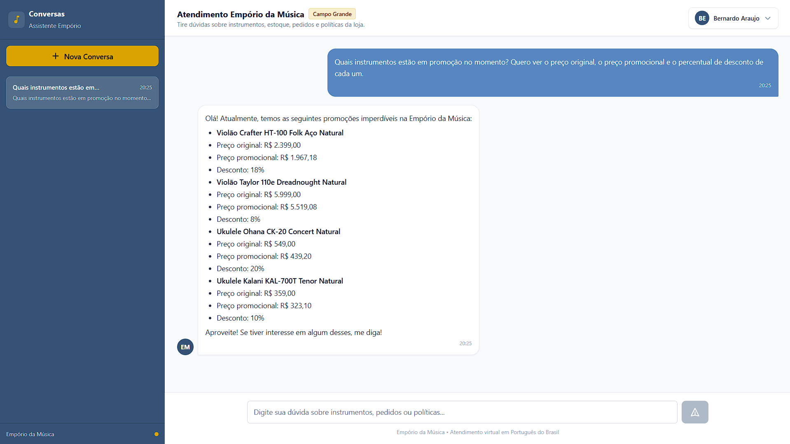

# Example 02: Active Promotions and Discounts

## Scenario & Objective
A customer asks the assistant which musical instruments are currently on promotion, requesting their original prices, promotional prices, and discount percentages.

The assistant must:
- Query active promotional campaigns from PostgreSQL.
- Retrieve original prices from `products` joined with `promotions`.
- Calculate promotional prices deterministically in Python rather than relying on LLM math hallucination.
- Format the response with clarity in Brazilian Portuguese.

---

## Customer Question
> "Quais instrumentos estão em promoção no momento? Quero ver o preço original, o preço promocional e o percentual de desconto de cada um."

---

## Tools Invoked

### 1. `search_promotions`
- **Purpose**: Search active promotional campaigns from PostgreSQL, calculate promotional prices deterministically using Python `Decimal`, and filter expired campaigns.
- **Execution Order**: 1
- **Arguments**:
  ```json
  {
    "only_active": true
  }
  ```
- **Relevant Tool Output**:
  ```json
  {
    "total_active_promotions": 4,
    "promotions": [
      {
        "product_name": "Crafter HT-100 Folk Aço Natural",
        "category": "Violões",
        "discount_percent": 18.0,
        "original_price_brl": 2399.0,
        "promotional_price_brl": 1967.18,
        "description": "Desconto Exclusivo",
        "is_active": true
      },
      {
        "product_name": "Taylor 110e Dreadnought Natural",
        "category": "Violões",
        "discount_percent": 8.0,
        "original_price_brl": 5999.0,
        "promotional_price_brl": 5519.08,
        "description": "Desconto Exclusivo",
        "is_active": true
      },
      {
        "product_name": "Ohana CK-20 Concert Natural",
        "category": "Ukuleles",
        "discount_percent": 20.0,
        "original_price_brl": 549.0,
        "promotional_price_brl": 439.2,
        "description": "Desconto Exclusivo",
        "is_active": true
      },
      {
        "product_name": "Kalani KAL-700T Tenor Natural",
        "category": "Ukuleles",
        "discount_percent": 10.0,
        "original_price_brl": 359.0,
        "promotional_price_brl": 323.1,
        "description": "Oferta Especial",
        "is_active": true
      }
    ]
  }
  ```

---

## Agent Response (Original Transcript)
> Olá! Atualmente, temos as seguintes promoções imperdíveis na Empório da Música:
>
> *   **Violão Crafter HT-100 Folk Aço Natural**
>     *   Preço original: R$ 2.399,00
>     *   Preço promocional: R$ 1.967,18
>     *   Desconto: 18%
>
> *   **Violão Taylor 110e Dreadnought Natural**
>     *   Preço original: R$ 5.999,00
>     *   Preço promocional: R$ 5.519,08
>     *   Desconto: 8%
>
> *   **Ukulele Ohana CK-20 Concert Natural**
>     *   Preço original: R$ 549,00
>     *   Preço promocional: R$ 439,20
>     *   Desconto: 20%
>
> *   **Ukulele Kalani KAL-700T Tenor Natural**
>     *   Preço original: R$ 359,00
>     *   Preço promocional: R$ 323,10
>     *   Desconto: 10%
>
> Aproveite! Se tiver interesse em algum desses, me diga!

---

## Evidence & Verification
- **Retrieval Category**: Relational database query (`promotions` joined with `products`) with deterministic Python discount calculations.
- **Observed Results**: In this execution, the tool identified four active promotions (`total_active_promotions: 4`), matching the items, discounts, and promotional prices presented in the assistant's response.
- **UI Screenshot**:
  
