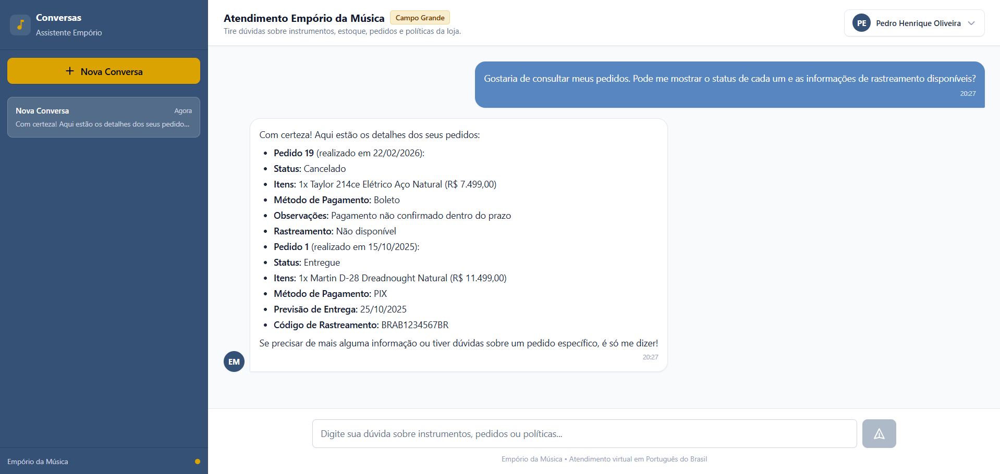

# Example 03: Customer Orders & Data Isolation

## Scenario & Objective
An authenticated customer accesses the chat interface and asks for the status, products, dates, and values of their orders.

Key architectural and privacy aspects:
- The agent retrieves orders associated with the authenticated user context.
- The `customer_id` is derived from the backend session (`current_user.customer_id`) rather than provided by the model or prompt.
- The assistant presents order items, values, dates, and shipping tracking codes without exposing sensitive customer personal data (such as internal database identifiers, emails, phones, or document numbers).

---

## Customer Question
> "Gostaria de consultar meus pedidos. Pode me mostrar o status de cada um e as informações de rastreamento disponíveis?"

---

## Tools Invoked

### 1. `get_customer_orders`
- **Purpose**: Retrieve orders for the authenticated customer directly from PostgreSQL.
- **Execution Order**: 1
- **Arguments**:
  ```json
  {}
  ```
  *(Note: `customer_id` is injected directly from the authenticated session context in Python; the model does not supply or override this identifier).*
- **Relevant Tool Output**:
  ```json
  {
    "orders": [
      {
        "order_id": 19,
        "order_date": "2026-02-22",
        "status": "cancelled",
        "total_brl": 7499.0,
        "payment_method": "boleto",
        "tracking_code": null,
        "estimated_delivery": null,
        "notes": "Pagamento não confirmado dentro do prazo",
        "items": [
          {
            "product_name": "Taylor 214ce Elétrico Aço Natural",
            "quantity": 1,
            "unit_price_brl": 7499.0
          }
        ]
      },
      {
        "order_id": 1,
        "order_date": "2025-10-15",
        "status": "delivered",
        "total_brl": 11499.0,
        "payment_method": "pix",
        "tracking_code": "BRAB1234567BR",
        "estimated_delivery": "2025-10-25",
        "notes": null,
        "items": [
          {
            "product_name": "Martin D-28 Dreadnought Natural",
            "quantity": 1,
            "unit_price_brl": 11499.0
          }
        ]
      }
    ]
  }
  ```

---

## Agent Response (Original Transcript)
> Com certeza! Aqui estão os detalhes dos seus pedidos:
>
> *   **Pedido 19** (realizado em 22/02/2026):
>     *   **Status:** Cancelado
>     *   **Itens:** 1x Taylor 214ce Elétrico Aço Natural (R$ 7.499,00)
>     *   **Método de Pagamento:** Boleto
>     *   **Observações:** Pagamento não confirmado dentro do prazo
>     *   **Rastreamento:** Não disponível
>
> *   **Pedido 1** (realizado em 15/10/2025):
>     *   **Status:** Entregue
>     *   **Itens:** 1x Martin D-28 Dreadnought Natural (R$ 11.499,00)
>     *   **Método de Pagamento:** PIX
>     *   **Previsão de Entrega:** 25/10/2025
>     *   **Código de Rastreamento:** BRAB1234567BR
>
> Se precisar de mais alguma informação ou tiver dúvidas sobre um pedido específico, é só me dizer!

---

## Evidence & Verification
- **Context Binding**: The query was executed with `customer_id` sourced from the authenticated session, returning the two registered orders for this customer.
- **Implemented Guardrail**: The tool's implementation explicitly checks for an associated `customer_id` before querying, returning an error message if the account has no customer record.
- **Data Minimization**: In this interaction, internal session hashes and customer personal contact details were not included in the response.
- **UI Screenshot**:
  
