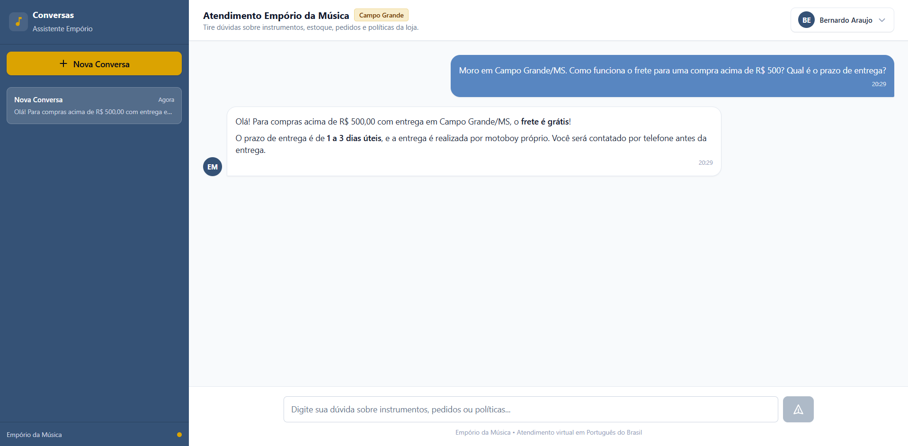

# Example 04: Delivery & Shipping Policies (Free Shipping in Campo Grande)

## Scenario & Objective
A customer based in Campo Grande/MS asks about shipping conditions for purchases over R$ 500 and the estimated delivery timeline.

The assistant must:
- Recognize that this question pertains to store policy documentation (`políticas_da_loja.pdf`) rather than the product database.
- Utilize the Hybrid RAG engine (pgvector cosine similarity + PostgreSQL Full-Text Search ranked via Reciprocal Rank Fusion).
- Retrieve the relevant section (Section 5.1: "Entregas na Região Metropolitana de Campo Grande").
- Provide an accurate, natural response in Brazilian Portuguese without exposing internal document page tags or chunk references to the customer.

---

## Customer Question
> "Moro em Campo Grande/MS. Como funciona o frete para uma compra acima de R$ 500? Qual é o prazo de entrega?"

---

## Tools Invoked

### 1. `search_store_policies`
- **Purpose**: Hybrid semantic and lexical retrieval on indexed document chunks with Reciprocal Rank Fusion (RRF, $k=60$).
- **Execution Order**: 1
- **Arguments**:
  ```json
  {
    "query": "frete para Campo Grande MS acima de 500 reais e prazo de entrega"
  }
  ```
- **Relevant Tool Output**:
  ```json
  {
    "total_results": 3,
    "chunks": [
      {
        "document_name": "Políticas Da Loja",
        "file_name": "políticas_da_loja.pdf",
        "page": 4,
        "excerpt": "5. Política de Frete e Entregas\n\n5.1 Entregas na Região Metropolitana de Campo Grande\n\n• Frete grátis para pedidos acima de R$ 500,00.\n\n• Para pedidos abaixo de R$ 500,00, taxa fixa de R$ 35,00.\n\n• Prazo de entrega: 1 a 3 dias úteis.\n\n• Entrega realizada por motoboy próprio. O cliente será contactado por telefone antes da\n\nentrega.",
        "score": 0.0328,
        "citation": "Políticas Da Loja, pág. 4"
      },
      {
        "document_name": "Políticas Da Loja",
        "file_name": "políticas_da_loja.pdf",
        "page": 4,
        "excerpt": "5. Política de Frete e Entregas\n\n5.2 Entregas para Outras Cidades\n\nUtilizamos os serviços dos Correios (PAC e SEDEX) e da transportadora Jadlog para envios fora da\n\nregião metropolitana de Campo Grande.\n\n| Modalidade | Prazo Estimado | Rastreamento | Seguro |\n| --- | --- | --- | --- |\n| PAC (Correios) | 5 a 12 dias úteis | Sim | Incluído |\n| SEDEX (Correios) | 2 a 5 dias úteis | Sim | Incluído |\n| Jadlog (.package) | 3 a 8 dias úteis | Sim | Incluído |\n\nO valor do frete é calculado automaticamente com base no CEP de destino, peso e dimensões do\n\nproduto. Instrumentos de grande porte (baterias acústicas, pianos digitais, contrabaixos) podem exigir\n\nfrete especial com cotação individual.\n\nTodos os envios incluem seguro contra extravios e danos durante o transporte. Em caso de avaria, o\n\ncliente deve recusar o recebimento e entrar em contato imediatamente com a loja.",
        "score": 0.0323,
        "citation": "Políticas Da Loja, pág. 4"
      }
    ]
  }
  ```

**Note:** The original retrieval returned three chunks (`total_results: 3`). Only the two relevant page-4 chunks are reproduced above. The third chunk contained unrelated cover-page information and was omitted from this example.

---

## Agent Response (Original Transcript)
> Olá! Para compras acima de R$ 500,00 com entrega em Campo Grande/MS, o **frete é grátis**!
>
> O prazo de entrega é de **1 a 3 dias úteis**, e a entrega é realizada por motoboy próprio. Você será contatado por telefone antes da entrega.

---

## Evidence & Verification
- **Retrieval Engine**: Hybrid RAG combining `pgvector` semantic similarity and PostgreSQL FTS (`to_tsvector('portuguese')`).
- **Citation Tracking**: Document citations and excerpt scores are preserved internally in the administrative audit trace (`message_events`) while cleanly omitted from the customer response.
- **UI Screenshot**:
  
