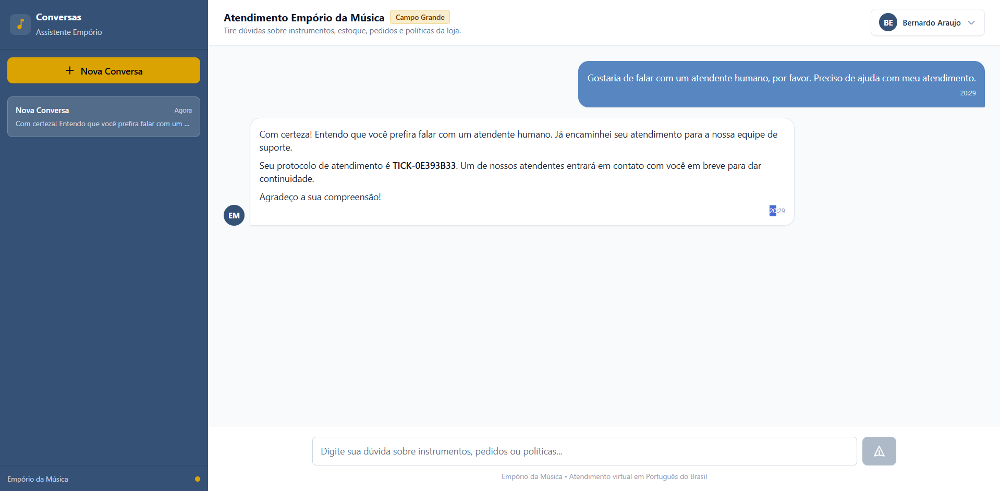

# Example 05: Human Escalation & Support Protocol

## Scenario & Objective
A customer requests to speak with a human attendant for assistance with their service.

The assistant must:
- Recognize the escalation trigger (customer request for a human attendant, or issues requiring store staff intervention).
- Avoid arguing or giving repetitive generic answers.
- Invoke `escalate_to_human_support` with a clear, concise justification.
- Generate a support protocol (`TICK-XXXXXXXX`).
- Store the support ticket in PostgreSQL so that administrators can view it on the `/admin/support` inbox.
- Reassure the customer with empathy and provide the protocol number.

---

## Customer Question
> "Gostaria de falar com um atendente humano, por favor. Preciso de ajuda com meu atendimento."

---

## Tools Invoked

### 1. `escalate_to_human_support`
- **Purpose**: Creates a support intervention request in PostgreSQL (`support_tickets` table), generates an alphanumeric protocol code, and marks the conversation as escalated.
- **Execution Order**: 1
- **Arguments**:
  ```json
  {
    "reason": "O cliente solicitou falar com um atendente humano para obter ajuda com o atendimento."
  }
  ```
- **Relevant Tool Output**:
  ```json
  {
    "escalated": true,
    "protocol": "TICK-0E393B33",
    "reason": "O cliente solicitou falar com um atendente humano para obter ajuda com o atendimento.",
    "message": "Atendimento encaminhado para nossa equipe humana com sucesso. Protocolo registrado: TICK-0E393B33. Um atendente dará continuidade em breve."
  }
  ```

---

## Agent Response (Original Transcript)
> Com certeza! Entendo que você prefira falar com um atendente humano. Já encaminhei seu atendimento para a nossa equipe de suporte.
>
> Seu protocolo de atendimento é **TICK-0E393B33**. Um de nossos atendentes entrará em contato com você em breve para dar continuidade.
>
> Agradeço a sua compreensão!

---

## Evidence & Verification
- **Administrative Integration**: The ticket was verified in the database (`support_tickets`) and displayed on the `/admin/support` dashboard with status `pending`.
- **Audit Trace**: The tool start and tool end events, along with the protocol `TICK-0E393B33` and escalation reason, are fully audited in `message_events`.
- **UI Screenshot**:
  
